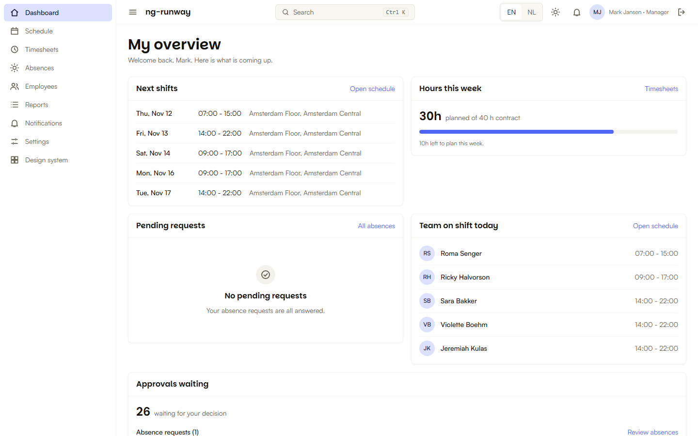
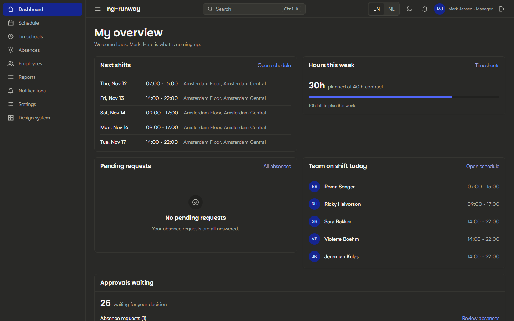
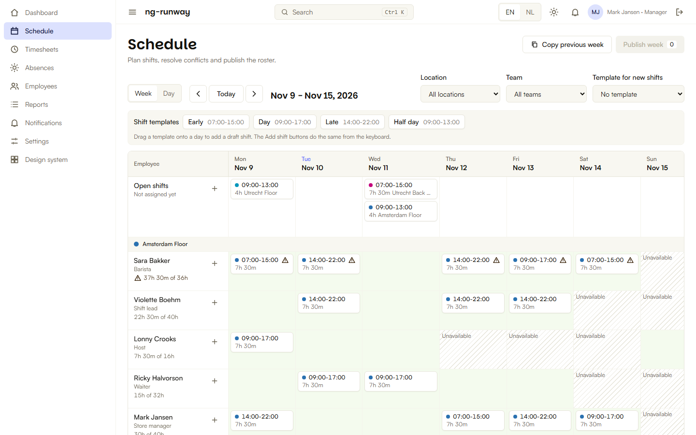
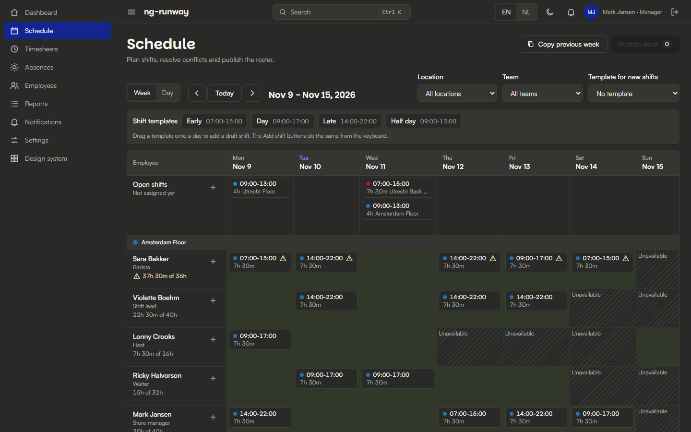

# ng-runway

Angular 22 admin dashboard boilerplate for workforce management. UI only, with a mocked API. Built on a token-based design system, so you can start fast and still explain every line.

[](https://stackblitz.com/github/jortega0033/ng-runway)

**Demo:** https://jortega0033.github.io/ng-runway/ (sign in with one click as Admin, Manager or Employee; data lives in your browser).

|                           Light                           |                          Dark                           |
| :-------------------------------------------------------: | :-----------------------------------------------------: |
|  |  |
|    |    |

More: timesheets, employees and the design-system page are in [docs/screenshots](docs/screenshots).

## What is in it

- **Schedule:** weekly roster, drag and drop shifts, templates, conflict warnings (overlap, absence, availability, overtime), copy week, publish.
- **Timesheets:** clock in/out with breaks, approval flow for managers.
- **Absences:** request, approve or reject, balances, shown on the schedule.
- **Employees, Reports (CSV export), Notifications, Settings** (theme, language, reset demo data).
- **Shell:** roles (admin, manager, employee), guards, command palette (Ctrl/Cmd+K), EN/NL switch, light and dark theme, offline banner, dev toolbar (slow network, random errors, empty data).
- **UI library:** about 35 components in `src/app/ui/` (forms, combobox, date and time pickers, table with virtual scroll, tabs, dialogs, toasts, SVG charts). Live catalog on `/design-system`, written catalog in [docs/components.md](docs/components.md).

## Stack and conventions

Standalone components, zoneless, signals, `inject()`, new control flow. Tailwind v4 with semantic tokens only, no UI kit (Angular Aria and CDK underneath). Signal Forms (plus one Reactive Forms example). Signal services for state, NgRx SignalStore for the schedule only. MSW mocks the API, and the app uses real `HttpClient` calls, so a real backend is a base URL change ([docs/adapting.md](docs/adapting.md)). Decisions are in [docs/adr](docs/adr).

## Three ways to use it

```bash
# 1. Tokens only: copy the design tokens (CSS, JSON, Tailwind theme, TypeScript)
npx github:jortega0033/ng-runway#v1.0.0 tokens

# 2. UI library: copy src/app/ui and the tokens into your own Angular app
npx github:jortega0033/ng-runway#v1.0.0 ui

# 3. Full boilerplate: a new app with everything, git initialised, dependencies installed
npx github:jortega0033/ng-runway#v1.0.0 create my-app
```

Or use the GitHub "Use this template" button. The CLI has no dependencies and never overwrites files unless you pass `--force`.

Then make it yours:

```bash
npm run strip                 # remove the workforce demo, keep the shell and one example feature
npm run gen:feature orders    # scaffold model, mock API, service, list/detail/form pages, routes, tests
```

## Design tokens

`tokens/tokens.css` and `tokens/tokens.json` are the source of truth. Never edit their values. `npm run tokens:build` regenerates `tokens/tailwind-theme.css` and `tokens/tokens.ts`, and `npm run tokens:check` fails if they drift. Components use semantic tokens (`--colors-*`) only: no raw hex, no `--palette-*`. Fonts (Satoshi from Fontshare, Parkinsans from Google Fonts) are loaded from their CDNs and are not committed.

## Scripts

| Command                                        | What it does                                                 |
| ---------------------------------------------- | ------------------------------------------------------------ |
| `npm ci --ignore-scripts`                      | Install exactly what the lockfile says                       |
| `npm start`                                    | Dev server on http://localhost:4200                          |
| `npm run build`                                | Production build with bundle budgets                         |
| `npm test -- --watch=false`                    | Unit and component tests (Vitest)                            |
| `npm run e2e`                                  | Playwright flows per role plus axe checks (needs a build)    |
| `npm run lint` / `format:check` / `typecheck`  | Quality gates                                                |
| `npm run verify`                               | Everything above, in CI order                                |
| `npm run strip` / `npm run gen:feature <name>` | Remove the demo / scaffold a feature                         |
| `npm run docs:components`                      | Rebuild docs/components.md from docs/components/\*.md        |
| `npm run hooks:install`                        | Husky with lint-staged and commitlint (conventional commits) |

Node 22 (see `.nvmrc`). Works on Windows, macOS and Linux. A devcontainer is included.

## Folder structure

```
tokens/            design tokens (source of truth + generated files)
src/app/core/      app-wide services: api, auth, http, mock (MSW), layout, i18n, theme, domain logic
src/app/ui/        UI library
src/app/features/  one folder per feature (routes, pages, components, tests)
src/app/design-system/  live component catalog
public/i18n/       EN and NL texts (global + one scope per feature)
e2e/               Playwright specs
scripts/           tokens, strip, gen:feature, docs and serve helpers
cli/               the zero-dependency npx CLI
docs/              ADRs, component catalog, adapting guide
drills/            timed practice exercises
```

Path aliases: `@core/*`, `@ui/*`, `@features/*`, `@tokens`.

## Works with the angular-engineer plugin

This repo was built with the [angular-engineer](https://github.com/jortega0033/angular-engineer) plugin for Claude Code, and it is set up for it: `CLAUDE.md` and `AGENTS.md` describe the conventions, `.claude/commands/` has `scaffold-feature` and `verify`, and `llms.txt` gives the short map for other agents.

## For timed assessments

[SUBMISSION.md](SUBMISSION.md) is a template for handing in work, and [drills/](drills) has practice tasks. [docs/adapting.md](docs/adapting.md) shows how to swap the mock API for a real one.

## License

MIT. Contributions: see [CONTRIBUTING.md](CONTRIBUTING.md).
